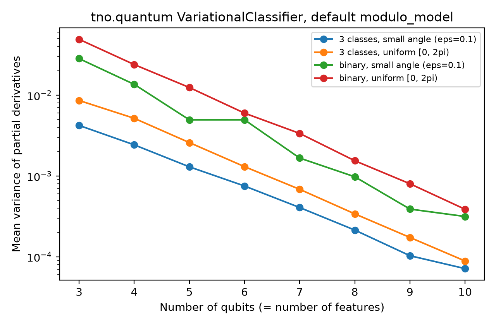

# Gradient variance in TNO Quantum's variational classifier

How fast do the gradients of the default model in [`tno.quantum.ml.classifiers.vc`](https://github.com/TNO-Quantum/ml.classifiers.vc) vanish as the number of features grows, and does small-angle initialisation help?



## Result

The variance of the gradient roughly **halves with every added qubit**, in all four settings tested. From 3 to 10 qubits, with the package's default initialisation, it falls **127-fold for binary tasks and 97-fold for three classes**. Small-angle initialisation does not change the rate.

| Task | Initialisation | Variance, 3 qubits | Variance, 10 qubits | Fitted factor per added qubit |
|---|---|---|---|---|
| binary | uniform [0, 2π) (default) | 4.90e-2 | 3.87e-4 | 0.50 |
| binary | small angle (ε = 0.1) | 2.83e-2 | 3.15e-4 | 0.52 |
| 3 classes | uniform [0, 2π) (default) | 8.58e-3 | 8.86e-5 | 0.52 |
| 3 classes | small angle (ε = 0.1) | 4.22e-3 | 7.13e-5 | 0.55 |

Full numbers: `gradient_variance.csv` and `decay_rates.csv`.

## What I expected, and what I think explains the difference

**Expected:** the binary readout measures ⟨Z⟩ on qubit 0 only, a local cost, so it should decay much more slowly than the three-class readout, which sums bit-string probabilities over all qubits. **Observed:** both decay at the same rate.

My reading, not tested here: in `StronglyEntanglingLayers` each sublayer applies its ring of CNOTs one after another, so a single sublayer already connects qubit 0 to every other qubit. At the package's default depth, the local readout therefore behaves like a global one.

**Expected:** small-angle initialisation restores trainability, as it does for the IQP circuits in my Sorbonne research project (Barren Plateaus in Parametrised IQP Circuits, 2026). **Observed:** it lowers the variance slightly and leaves the rate unchanged.

My reading, not tested here: the CNOTs remain at any angle and the RX data encoding is not small, so near-zero weights do not bring the circuit close to the identity. In IQP circuits the parametrised gates are the only source of entanglement, which is why small angles help there.

**Why it matters:** the package encodes one feature per qubit. Extrapolating the fitted rate (an extrapolation, not a measurement), a 20-feature dataset would start with gradients about 1,000 times smaller than a 10-feature one. Natural next tests: reducing features before encoding, and entangling layouts with a bounded light cone.

## Method

`trainability_check.py` builds the circuit through the package's own `ModelConfig("modulo_model")` and `get_qfunc`, so nothing is re-implemented. Defaults: 2 layers, 2 trainable sublayers, scaling 0.5, one qubit per feature, RX angle encoding, `default.qubit`. For each setting and each size from 3 to 10 qubits, it draws 100 random weight vectors and random inputs, differentiates the model output with PyTorch autograd (binary: ⟨Z₀⟩; three classes: probability of class 0), takes the variance of each partial derivative across samples, and averages over parameters. A log-linear fit gives the factor lost per added qubit.

```
pip install tno.quantum.ml.classifiers.vc matplotlib pandas
python trainability_check.py          # full run, about 1 minute on a laptop
python trainability_check.py --quick  # 3 to 8 qubits, 40 samples
```

## Limits

Noiseless simulator, default depth only, random inputs rather than a real dataset, one small-angle scale, 100 samples per point (so single points carry sampling noise, e.g. binary small-angle at 5 and 6 qubits). Variance at initialisation says nothing about where training ends up. Recent versions of `tno.quantum.utils` warn that `BackendConfig` is deprecated in favour of `DeviceConfig` in `tno.quantum.devices`; the run above still works.

Pablo González Lázaro, MSc Quantum Information, Sorbonne Université.
